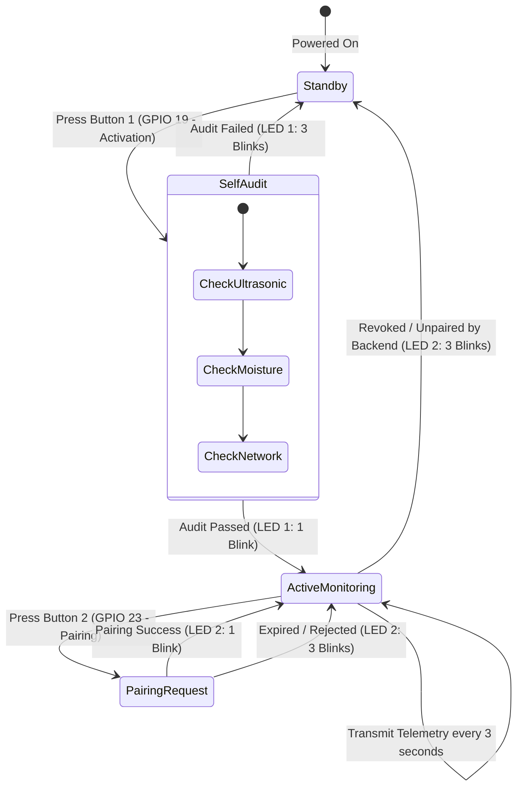

# ArvaNode: Physical IoT Field Monitoring Node Firmware

[](https://www.espressif.com)
[](https://arduino.cc)
[](https://espressif.com)

> Firmware and hardware specifications for the distributed sensor monitoring nodes deployed across rice paddy quadrants in the **ArvaCore** ecosystem.

---

## 1. Node Purpose & Hardware Architecture

The **ArvaNode** is an independent, battery-powered IoT field node responsible for real-time acquisition of field water depth and soil moisture under the Alternate Wetting and Drying (AWD) protocol.

### Microcontroller, Sensors & Controls
| Component | Function | Interface / Pin | Notes |
|:---|:---|:---|:---|
| **ESP32-WROOM-32** | Main controller & Wi-Fi uplink | — | 3.3V logic |
| **JSN-SR04T / HC-SR04** | Ultrasonic distance measurement | TRIG: `GPIO 5`<br>ECHO: `GPIO 18` | Sensor mounted atop still-well pipe (valid: $20.0 - 450.0\,\text{cm}$) |
| **Capacitive Soil Moisture v1.2** | Root-zone volumetric water content | Analog In: `GPIO 34` | Corrosion-resistant analog probe (ADC1_CH6, valid: $0.0 - 100.0\%$) |
| **Momentary Push Button 1** | Activation & Component Audit | Input Pull-Up: `GPIO 19` | Active-LOW. Powers on node logic and runs self-test audit |
| **Momentary Push Button 2** | Hardware Pairing Request Initiator | Input Pull-Up: `GPIO 23` | Active-LOW. Gated behind Activation Button (ignored if unactivated) |
| **LED 1 (Audit / Activation Status)** | Diagnostic feedback for Activation | Output: `GPIO 2` | 1 blink = audit pass / activated; 3 blinks = audit failure |
| **LED 2 (Pairing Status)** | Diagnostic feedback for Pairing | Output: `GPIO 4` | 1 blink = pairing approved / synced; 3 blinks = pairing error / expired |
| **Voltage Divider** | Echo 5V to 3.3V stepping | ECHO pin path | $1\,\text{k}\Omega$ / $2\,\text{k}\Omega$ divider for 3.3V ESP32 pin protection |

---

## 2. Still-Well Installation & Geometry

The water level measurement follows the field still-well configuration detailed in **Thesis Chapter 3**:
- A perforated PVC tube is driven into the soil.
- An internal float rises and falls according to the perched water table.
- The JSN-SR04T sensor head is positioned at the top of the tube, exactly **$20.0\,\text{cm}$ above the soil surface datum**.
- The distance $d$ measured by ultrasonic echo calculates water level $h$:
  $$h = 20.0\,\text{cm} - d$$
  - $d = 20.0\,\text{cm} \implies h = 0.0\,\text{cm}$ (Field soil surface datum)
  - $d = 35.0\,\text{cm} \implies h = -15.0\,\text{cm}$ (AWD reflood threshold)
  - $d = 15.0\,\text{cm} \implies h = +5.0\,\text{cm}$ (Target ponded flood depth)

---

## 3. Operational Workflow: Dual-Button & LED Feedback



1. **Activation Button (`GPIO 19`)**:
   - Must be pressed first to activate the node. Pressing Button 2 (Pairing) before activation is ignored.
   - Triggers an initial diagnostic audit across all connected sensors and Wi-Fi connectivity.
   - **Audit Result Indication (LED 1)**:
     - **1 Blink**: All hardware components functional; node transitions to `ACTIVATED`.
     - **3 Blinks**: Hardware sensor failure, disconnected probe, or out-of-range sensor detection.
2. **Pairing Button (`GPIO 23`) & Pairing Lifecycle**:
   - Initiates a hardware pairing request to the ArvaCore gateway / backend.
   - **Permanent Accepted Pairings**: Once accepted by the operator, pairings persist indefinitely across node deep sleep, power cycles, and network disconnects.
   - **30-Minute Pending Expiration**: Unaccepted pairing requests strictly expire after 30 minutes, after which the node clears pending credentials and signals expiration.
   - **Remote Unpairing & Revocation Handling**: If an operator forcefully unpairs the node via the backend API/UI (`DELETE /api/v1/nodes/{nodeId}/pairing`), subsequent telemetry uplinks (HTTP 401/403/`NODE_NOT_ACTIVE`/`REVOKED`) automatically trigger firmware unpairing: local credentials are purged, the node reverts to an unverified state, LED 2 flashes 3 times, and further telemetry is halted until a new pairing sequence is approved.
   - **Pairing Feedback (LED 2)**:
     - **1 Blink**: Pairing approved by administrator or active pairing session confirmed.
     - **3 Blinks**: Pairing failed, rejected, expired (30m window elapsed), or revoked.
3. **Mandatory 3-Second Telemetry Policy**:
   - In active operational mode, the node samples and transmits telemetry every **3 seconds** (`TELEMETRY_INTERVAL_MS = 3000UL`).

---

## 4. Sensor Bounds & Truthful Measurement Invariants

The firmware adheres to strict measurement truthfulness:
- **Ultrasonic Distance**: Plausible physical range is $20.0\,\text{cm}$ to $450.0\,\text{cm}$. Readings outside this range, echo timeouts, or sensor disconnection produce an explicit error indicator (`-1.0` or null), never a fabricated zero.
- **Valid Zero vs. Sensor Error**:
  - A water depth of $0.0\,\text{cm}$ corresponds to the physical soil surface ($d = 20.0\,\text{cm}$) and is preserved as a valid numeric reading.
  - A soil moisture reading of $0.0\%$ (bone dry soil) is preserved as a valid numeric reading, distinct from a disconnected probe error condition.
- **Capacitive Soil Moisture**: Calibrated ADC range ($0.0 - 100.0\%$).
- **Battery Monitoring**: Operating range $2.5\,\text{V} - 5.0\,\text{V}$.

---

## 5. Telemetry Payload Format

```json
{
  "nodeId": "NODE-01",
  "seq": 101,
  "water_level_distance": 25.5,
  "waterLevelCm": -5.5,
  "soilMoisturePercent": 42.0,
  "batteryVoltage": 4.15,
  "sensorError": false
}
```

---

---

## 5. Dynamic Node Provisioning & Identity Management

ArvaCore replaces static, manual firmware modifications with a centralized provisioning system supporting up to **10 uniquely identified ESP32 nodes** (`ARVANODE-001` through `ARVANODE-010`):

| Profile | Logical Identity | Default Display Name | Role & Placement |
|:---:|:---|:---|:---|
| **1** | `ARVANODE-001` | ArvaNode Field 01 | Paddy Quadrant 1 (North-West) |
| **2** | `ARVANODE-002` | ArvaNode Field 02 | Paddy Quadrant 2 (North-East) |
| **3** | `ARVANODE-003` | ArvaNode Field 03 | Paddy Quadrant 3 (South-West) |
| **4** | `ARVANODE-004` | ArvaNode Field 04 | Paddy Quadrant 4 (South-East) |
| **5** | `ARVANODE-005` | ArvaNode Field 05 | Lateral Feeder Inlet |
| **6** | `ARVANODE-006` | ArvaNode Field 06 | Central Drain Checkpoint |
| **7** | `ARVANODE-007` | ArvaNode Field 07 | Low-Lying Depression Zone |
| **8** | `ARVANODE-008` | ArvaNode Field 08 | Elevated Ridge Perimeter |
| **9** | `ARVANODE-009` | ArvaNode Field 09 | Main Pump Sump / Still-Well |
| **10** | `ARVANODE-010` | ArvaNode Field 10 | Perimeter Reserve Zone |

### Provisioning Tool: `scripts/node_provisioner.py`

```bash
# List all generated provisioning profiles
python3 scripts/node_provisioner.py list

# Generate the next available profile (auto-selected from default pool)
python3 scripts/node_provisioner.py generate

# Generate or overwrite a specific logical profile
python3 scripts/node_provisioner.py generate --id ARVANODE-004 --name "ArvaNode Field 04" --force

# Inspect profile configuration (secrets redacted by default)
python3 scripts/node_provisioner.py inspect ARVANODE-001

# Inspect raw profile with secrets unmasked (for technician bench provisioning)
python3 scripts/node_provisioner.py inspect ARVANODE-001 --show-secrets

# Validate all profile configurations against schema and system invariants
python3 scripts/node_provisioner.py validate

# Export C/C++ build configuration header (node_config.h)
python3 scripts/node_provisioner.py export-header ARVANODE-001
```

> [!SECURITY]
> **Secret Management**: Device credentials (`dev_sec_***`), gateway keys, and Wi-Fi secrets are saved locally with restrictive POSIX permissions (`0600`) in `provisioning/profiles/` and excluded from Git via `.gitignore`. The repository only tracks `provisioning/profile_template.json`.

---

## 6. ESP32 Auto-Flasher Tooling (`scripts/esp32_flasher.py`)

The auto-flasher bridges the identity generator directly with the Arduino CLI toolchain (`esp32:esp32:esp32`):

```bash
# Detect connected USB-to-UART serial adapters (CP2102, CH340, FTDI)
python3 scripts/esp32_flasher.py devices

# Build firmware for a profile without flashing (dry-run preview)
python3 scripts/esp32_flasher.py build --id ARVANODE-001 --dry-run

# Preview planned flashing command and port target
python3 scripts/esp32_flasher.py flash --id ARVANODE-001 --dry-run

# Build and flash an existing profile to a specific serial port
python3 scripts/esp32_flasher.py flash --id ARVANODE-001 --port /dev/ttyUSB0

# One-step provision, build, flash, and verify
python3 scripts/esp32_flasher.py provision --id ARVANODE-002 --port /dev/ttyUSB0

# Reconnect and verify boot banner emitted by hardware
python3 scripts/esp32_flasher.py verify --port /dev/ttyUSB0 --expected-id ARVANODE-002

# Produce an audit report of all profiles and their flash history
python3 scripts/esp32_flasher.py report
```

### Manual Bootloader Recovery Procedure
If flashing halts with `A fatal error occurred: Failed to connect to ESP32: No serial data received`:
1. Press and **HOLD** the `BOOT` button on the ESP32 development board.
2. While holding `BOOT`, tap the `EN` / `RST` button once.
3. Release `BOOT` when the terminal displays `Connecting........_____`.
4. Press `EN` after upload completes to reset into runtime monitoring.

---

## 7. Sensor Calibration & Known Electrical Findings

1. **JSN-SR04T / HC-SR04 Ultrasonic Sensor**:
   - Accurately converts float distance into water height relative to datum:
     $$\text{Water Level} = \text{Datum (20.0 cm)} - \text{Measured Distance (cm)}$$
   - Operational range: $2.0\,\text{cm}$ to $450.0\,\text{cm}$.
2. **Resistive Soil Moisture Sensor Warning**:
   - Prior laboratory audits revealed ADC saturation stuck at `4095` on `GPIO 34` when using low-grade resistive probes or floating inputs.
   - **Policy**: The firmware truthfully reports raw readings and flags sensor errors rather than fabricating valid soil moisture numbers. Always inspect physical wiring and ensure clean probe excitation grounding before deployment.

---

## 8. Automated Tooling & Integration Tests

Execute the automated test suite covering profile generation, duplicate rejection, 10-node limit enforcement, dry-run simulation, and hardware verification:

```bash
# Run unit tests for provisioner and auto-flasher
python3 -m unittest tests/test_provisioning_and_flasher.py
```
*Result: 15 / 15 tests passing cleanly (`OK`).*


