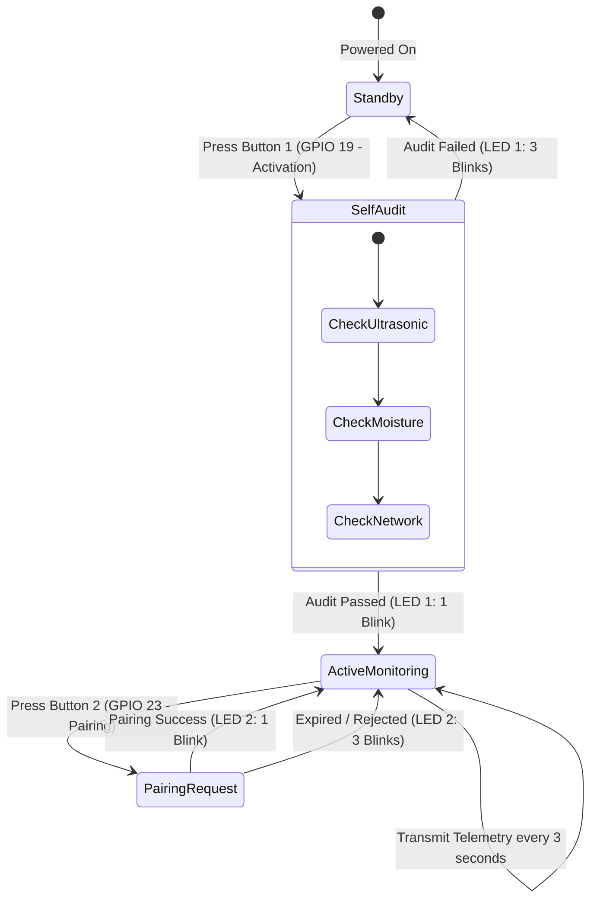

# ArvaNode: Physical IoT Field Monitoring Node Firmware

[](https://www.espressif.com)
[](https://arduino.cc)
[](https://espressif.com)

> Firmware and hardware specifications for the distributed sensor monitoring nodes deployed across rice paddy quadrants in the **ArvaCore** ecosystem.

---

## 1. Node Purpose & Hardware Architecture

The **ArvaNode** is an independent, battery-powered IoT field node responsible for real-time acquisition of field water depth and soil moisture under the Alternate Wetting and Drying (AWD) protocol.

### Microcontroller, Sensors & Controls
| Component | Function | Interface / Pin | Notes |
|:---|:---|:---|:---|
| **ESP32-WROOM-32** | Main controller & Wi-Fi uplink | — | 3.3V logic |
| **JSN-SR04T / HC-SR04** | Ultrasonic distance measurement | TRIG: `GPIO 5`<br>ECHO: `GPIO 18` | Sensor mounted atop still-well pipe (valid: $20.0 - 450.0\,\text{cm}$) |
| **Capacitive Soil Moisture v1.2** | Root-zone volumetric water content | Analog In: `GPIO 34` | Corrosion-resistant analog probe (ADC1_CH6, valid: $0.0 - 100.0\%$) |
| **Momentary Push Button 1** | Activation & Component Audit | Input Pull-Up: `GPIO 19` | Active-LOW. Powers on node logic and runs self-test audit |
| **Momentary Push Button 2** | Hardware Pairing Request Initiator | Input Pull-Up: `GPIO 23` | Active-LOW. Gated behind Activation Button (ignored if unactivated) |
| **LED 1 (Audit / Activation Status)** | Diagnostic feedback for Activation | Output: `GPIO 2` | 1 blink = audit pass / activated; 3 blinks = audit failure |
| **LED 2 (Pairing Status)** | Diagnostic feedback for Pairing | Output: `GPIO 4` | 1 blink = pairing approved / synced; 3 blinks = pairing error / expired |
| **Voltage Divider** | Echo 5V to 3.3V stepping | ECHO pin path | $1\,\text{k}\Omega$ / $2\,\text{k}\Omega$ divider for 3.3V ESP32 pin protection |

---

## 2. Still-Well Installation & Geometry

The water level measurement follows the field still-well configuration detailed in **Thesis Chapter 3**:
- A perforated PVC tube is driven into the soil.
- An internal float rises and falls according to the perched water table.
- The JSN-SR04T sensor head is positioned at the top of the tube, exactly **$20.0\,\text{cm}$ above the soil surface datum**.
- The distance $d$ measured by ultrasonic echo calculates water level $h$:
  $$h = 20.0\,\text{cm} - d$$
  - $d = 20.0\,\text{cm} \implies h = 0.0\,\text{cm}$ (Field soil surface datum)
  - $d = 35.0\,\text{cm} \implies h = -15.0\,\text{cm}$ (AWD reflood threshold)
  - $d = 15.0\,\text{cm} \implies h = +5.0\,\text{cm}$ (Target ponded flood depth)

---

## 3. Operational Workflow: Dual-Button & LED Feedback



1. **Activation Button (`GPIO 19`)**:
   - Must be pressed first to activate the node. Pressing Button 2 (Pairing) before activation is ignored.
   - Triggers an initial diagnostic audit across all connected sensors and Wi-Fi connectivity.
   - **Audit Result Indication (LED 1)**:
     - **1 Blink**: All hardware components functional; node transitions to `ACTIVATED`.
     - **3 Blinks**: Hardware sensor failure, disconnected probe, or out-of-range sensor detection.
2. **Pairing Button (`GPIO 23`)**:
   - Initiates a hardware pairing request to the ArvaCore gateway / backend.
   - Pairing window adheres to a strict **30-minute authoritative expiration window**.
   - **Pairing Feedback (LED 2)**:
     - **1 Blink**: Pairing approved by administrator or active pairing session confirmed.
     - **3 Blinks**: Pairing failed, rejected, or 30-minute authorization window expired.
3. **Mandatory 3-Second Telemetry Policy**:
   - In active operational mode, the node samples and transmits telemetry every **3 seconds** (`TELEMETRY_INTERVAL_MS = 3000UL`).

---

## 4. Sensor Bounds & Truthful Measurement Invariants

The firmware adheres to strict measurement truthfulness:
- **Ultrasonic Distance**: Plausible physical range is $20.0\,\text{cm}$ to $450.0\,\text{cm}$. Readings outside this range, echo timeouts, or sensor disconnection produce an explicit error indicator (`-1.0` or null), never a fabricated zero.
- **Valid Zero vs. Sensor Error**:
  - A water depth of $0.0\,\text{cm}$ corresponds to the physical soil surface ($d = 20.0\,\text{cm}$) and is preserved as a valid numeric reading.
  - A soil moisture reading of $0.0\%$ (bone dry soil) is preserved as a valid numeric reading, distinct from a disconnected probe error condition.
- **Capacitive Soil Moisture**: Calibrated ADC range ($0.0 - 100.0\%$).
- **Battery Monitoring**: Operating range $2.5\,\text{V} - 5.0\,\text{V}$.

---

## 5. Telemetry Payload Format

```json
{
  "nodeId": "NODE-01",
  "seq": 101,
  "water_level_distance": 25.5,
  "waterLevelCm": -5.5,
  "soilMoisturePercent": 42.0,
  "batteryVoltage": 4.15,
  "sensorError": false
}
```

---

## 6. Build, Flash & Simulation

### Uploading to ESP32 via Arduino IDE or CLI
1. Install ESP32 board definitions in Arduino IDE (`Tools > Board > ESP32 Dev Module`).
2. Open [`sketch_oct11a/sketch_oct11a.ino`](sketch_oct11a/sketch_oct11a.ino).
3. Set your target gateway IP and Wi-Fi SSID:
   ```cpp
   const char* WIFI_SSID = "ARVACORE_GATEWAY";
   const char* WIFI_PASS = "arvacore2026";
   const char* BACKEND_URL = "https://api-aquaflow.gladwindr.me/api/v1/telemetry/uplink/NODE-01";
   const char* GATEWAY_KEY = "ed630e681ef735f36954469b48f832f210286246ca95fff62e62086cab74e8a9";
   ```
4. Compile and upload to your ESP32 board over USB.

### Testing Without Hardware (Python Uplink Simulator)
Use [`test_uplink_gateway.py`](test_uplink_gateway.py) to simulate an ArvaNode transmitting telemetry to a running backend:
```bash
python3 test_uplink_gateway.py
```
Expected output:
```text
[SUCCESS] Gateway HTTP 200: {"status":"SUCCESS","readingsIngested":3}
```

